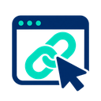
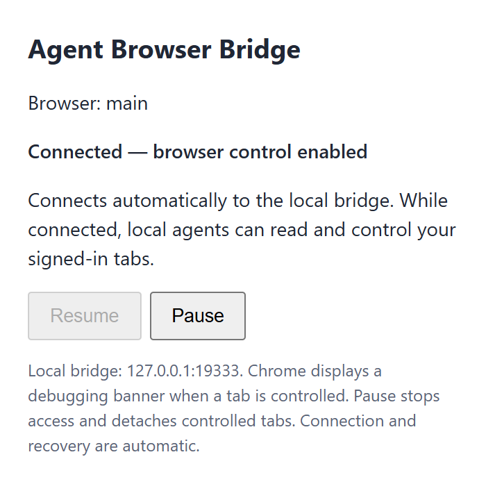
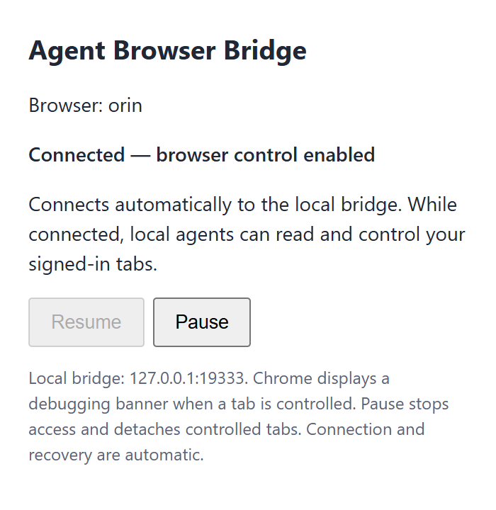

# Agent Browser Bridge



Control your existing, signed-in Chrome from any agent that can run a shell command or connect to an MCP server. Install the unpacked extension in the Chrome profile you already use. It connects automatically to a local service and controls that profile's existing tabs with their existing cookies and logins. No token or pairing step is required. You do not need a separate browser, a remote debugging launch flag, or to export cookies.

Control multiple Chrome profiles through one bridge, select them by nickname, upload files, retrieve downloads, take screenshots, and record silent video. Agents on another machine can use the same browsers through the authenticated HTTPS gateway.

| `main` profile | `orin` profile |
| --- | --- |
|  |  |

Actual extension screenshots from two disposable Chromium profiles connected to one bridge. Each profile has its own identity and nickname. Normal use connects automatically; **Pause** stops access to that profile.

This is an early developer release, available as an unpacked extension. Automated tests exercise the CLI, MCP, two isolated Chromium profiles, cookie isolation, uploads, downloads, managed groups, screenshots, and video. Individual agent configurations and your signed-in browser profile require separate validation.

## Install and start

Requires Node.js 22 or newer and Chrome 120 or newer.

1. Clone this repository and run `npm install` in its directory.
2. Open `chrome://extensions`, turn on **Developer mode**, click **Load unpacked**, and select this repository's `extension` directory.
3. Run a browser command. It starts the local bridge if needed and waits for the extension to connect automatically:

```sh
node bin/cli.js call tabs.list '{}'
node bin/cli.js status
```

No popup interaction is needed for normal use. Browser commands wait up to 35 seconds for the installed extension; `status` reports the current state without starting a bridge. `npm start` remains available to run the bridge in the foreground. Use **Pause** in the popup to explicitly pause browser access, and **Resume** after that deliberate pause. Temporary connection failures and bridge restarts reconnect automatically. Chrome displays its debugging indicator when a tab is being controlled.

If updating an older unpacked extension, reload it once in `chrome://extensions` to refresh its popup and service worker. No pairing token is needed.

### Updating the extension

After pulling new extension code, reload it from the command line instead of visiting `chrome://extensions`:

```sh
node bin/cli.js --browser orin extension          # version, code hash, and whether it matches this checkout
node bin/cli.js --browser orin extension reload   # reload from disk, wait for reconnect, report the new hash
```

On connect, the extension sends its manifest version and a SHA-256 hash of its source files (CRLF normalized, so Windows and POSIX checkouts agree). The bridge hashes the same files in its own `extension` directory. `extension` prints both: `extension.current` is `true` when the code running in Chrome matches the checkout, which tells you which code is live. `bridge.git` is the commit the bridge process started from; `bridge.restartNeeded` means the checkout has moved since then and the bridge itself should be restarted. `serve` logs a warning when a connecting extension does not match.

`extension reload` calls `chrome.runtime.reload()`, then waits up to 25 seconds for the reloaded worker to reconnect. Chrome keeps an unpacked extension enabled across a reload only while **Developer mode** is on, which it already is after **Load unpacked**. Extensions older than this command report `Unknown method`, so they need one last manual reload, or a Chrome restart.

## Browser nicknames

Give your connected Chrome profile a memorable name, then select it explicitly in agent commands:

```sh
node bin/cli.js browser
node bin/cli.js browser name main
node bin/cli.js browsers
node bin/cli.js --browser main call tabs.list '{}'
node bin/cli.js --browser orin call tabs.list '{}'
```

`browser` reports the connected browser's ID, nickname, and connection state. Names start with a letter, contain up to 32 letters, digits, underscores, or hyphens, and are stored in lowercase. Each nickname belongs to one browser. Names persist in `~/.agent-browser/browser-names.json` across bridge restarts.

Use `--browser main` to pin commands to that browser. A mismatched or disconnected selection fails instead of controlling whichever browser happens to be connected. You can also select the stable browser ID. Omitting the selector works when exactly one browser is connected; with multiple connections, select one explicitly.

Install the extension in each Chrome profile you want to control. Name each profile while it is selected, then use `browsers` to inspect connected IDs and nicknames. For example, keep your everyday profile named `main` and another named `orin`, and pass the desired name with each agent command.

One shared bridge on port `19333` supports multiple profiles concurrently. Load the **same extension directory** in each profile; do not copy the extension, edit its port, or start a service per profile. Each profile stores its own stable UUID. Use `--browser ID browser name NAME` to assign any nickname, then select it on each CLI command or with the MCP tool's `browser` property. Offline aliases remain visible in `browsers` with `connected: false`. Different profiles can work concurrently; actions within each profile are serialized. One outbound desktop daemon carries every profile to authenticated remote agents.

If an agent claims only one profile is supported, have it read this checkout's current skills and tool definitions. After upgrading an older unpacked extension, reload it once in each profile to activate the worker's UUID identity. Normal operation needs no Connect click.

## Managed browser tabs

Tabs created, navigated, or inspected through page commands are automatically placed in a visible agent group labeled with the browser nickname, such as `🤖 Agent · main`. `tabs.list` reports each tab's `groupId` and `managed` state. Tabs opened by a page, including `window.open` popups, appear in the list with their `openerTabId`; use that tab ID with the same page, navigation, and close commands.

```sh
node bin/cli.js --browser main call groups.list '{}'
node bin/cli.js --browser main call groups.release '{"tabId":123}'
node bin/cli.js --browser main call groups.manage '{"tabId":123}'
```

Releasing a managed tab ungroups it and detaches the debugger. Inspecting or controlling it again can manage it again. `groups.manage` optionally accepts `title` and `color` for a custom group appearance.

## Uploads and downloads

Upload a file from the agent's computer into a page's file input:

```sh
node bin/cli.js --browser main upload 123 'input[type=file]' ./report.pdf
```

The client transfers the file to the desktop bridge and selects it in the page; submit the form separately when intended. This works through the HTTPS gateway too, so remote agents do not need a desktop filesystem path. Multiple files may follow the selector. MCP `page_upload` performs the same transfer. Generic `page.upload` calls instead require paths that already exist on the desktop.

Staging accepts up to 64 MiB per file. Copies remain under `~/.agent-browser/uploads` on the desktop so a page can submit them later. CLI and MCP upload read specific client paths; generic page upload validates specific desktop paths. This does not provide a general filesystem browsing interface.

```sh
node bin/cli.js --browser main download https://example.com/report.pdf --filename reports/report.pdf
node bin/cli.js --browser main downloads list
node bin/cli.js --browser main downloads info 5
node bin/cli.js --browser main downloads wait 5
node bin/cli.js --browser main downloads save 5 --output ./report.pdf
```

Use the download ID returned by `download`. Metadata reports the state and absolute `filename` on the Chrome computer, including when the agent runs remotely. An optional filename is relative to Chrome's downloads directory; wait for completion before using the file. Downloading through Chrome preserves the selected profile's existing login session.

`downloads save` copies a completed Chrome download to a new file on the agent's computer, including through the HTTPS gateway. It does not overwrite existing output files. MCP `downloads_save` provides the same transfer. The Chrome metadata's absolute desktop filename and the agent's chosen output path belong to different computers when used remotely.

## Mouse input

Popup menus, hover cards, and side panels often react only to real pointer events. `click`, `hover`, and `mouse` send Chrome DevTools `Input.dispatchMouseEvent` input, not `element.click()` from page JavaScript. Coordinates are viewport CSS pixels, the same space as `getBoundingClientRect()` and screenshot pixels at 100% zoom. A selector is scrolled into view and targeted at its center.

```sh
node bin/cli.js --browser main click 123 640 360
node bin/cli.js --browser main click 123 'button[aria-label="More"]' --button right
node bin/cli.js --browser main click 123 640 360 --count 2
node bin/cli.js --browser main hover 123 'nav .account'
node bin/cli.js --browser main hover 123 1180 90
node bin/cli.js --browser main mouse move 123 200 300
node bin/cli.js --browser main mouse down 123
node bin/cli.js --browser main mouse move 123 400 300
node bin/cli.js --browser main mouse up 123
```

Every click moves the pointer to the target first, so hover state is in place before the press. `mouse down` and `mouse up` default to the last pointer position in that tab and accept `--button left|right|middle`; moves while a button is held report it as a drag. The generic and MCP forms are `page.click`, `page.hover`, and `page.mouse`. After pulling these commands, run `extension reload` (or, for an extension older than that command, reload it once in `chrome://extensions`) so the browser side knows `page.hover` and `page.mouse`. `Unknown method: page.hover` always comes from an outdated extension: the bridge forwards page methods unchanged.

## Screenshots and video

Get a tab ID from `tabs.list`, then save a screenshot directly to a new file:

```sh
node bin/cli.js --browser main screenshot 123 --output screenshot.png
```

A `.jpg` or `.jpeg` output suffix selects JPEG; other suffixes produce PNG. Missing parent folders are created, so `--output scratch\x.png` works on Windows without creating `scratch` first. Existing files are not overwritten. `downloads save --output` creates parent folders the same way. MCP `page_screenshot` returns image content directly, and the generic `page.screenshot` command returns base64 data.

Record a tab to silent WebM video:

```sh
node bin/cli.js --browser main record start 123 --output demo.webm
node bin/cli.js --browser main record list
node bin/cli.js --browser main record stop RECORDING_ID
```

Use the recording ID returned by `record start`. Install FFmpeg on the computer running the bridge and make `ffmpeg` available on PATH, or set `AGENT_BROWSER_FFMPEG` to its executable path. Recording captures browser frames without audio. With a remote agent, recording output paths refer to the computer running the bridge.

## Agents on Hetzner or another machine

### Saved, authenticated remote access

Use shared device login at **https://tools.dtcdev.click/browser**. The desktop
runs an outbound TLS daemon; controlling machines need no SSH tunnel or shared
secret file. Sign in and approve each machine using the same DTC device flow as
Dapier, DataOps and Hub.

On the desktop, authorize the daemon once, then keep it running:

```sh
node bin/cli.js auth login --daemon --device desktop
node bin/cli.js daemon
```

On a controlling machine:

```sh
node bin/cli.js auth login --device desktop
node bin/cli.js auth status
node bin/cli.js --remote desktop --browser orin call tabs.list '{}'
node bin/cli.js --remote desktop --browser main mcp
```

`auth login` prints a verification link and code. Open the link, sign in through
the existing shared Google/Cognito login and approve the displayed request.
Credentials are unique to the machine and role, stored privately with a 30-day
expiry, and revocable from the browser portal or using `auth logout` (add
`--daemon` for the daemon credential). `remote check desktop` verifies browser
connectivity. A paused/offline desktop fails rather than falling back to another
browser. Uploads and downloads stream through the same authenticated connection.
The daemon can publish only its named device; controllers can access only
devices owned by their signed-in identity. The gateway terminates TLS and is
trusted to relay browser data; cookies and Chrome profiles remain on the desktop.

The shared login loop is vendored unchanged from DataTalksClub/auth; see
`vendor/README.md` for its source commit. Gateway deployment and the common
auth boundary for future tools are documented in `deploy/tools/README.md`.

## Use from an agent

Repository-local skills are available as [browser-control](skills/browser-control/SKILL.md) for local agents and [remote-browser-control](skills/remote-browser-control/SKILL.md) for agents on Hetzner or another machine. They resolve the CLI relative to this checkout and do not install anything into your agent configuration.

Give any shell-capable agent the absolute path to this checkout and tell it to run commands such as:

```sh
node /absolute/path/to/agent-browser/bin/cli.js call tabs.list '{}'
```

For an agent launched with `zcy`, install the extension once, then launch your usual `zcy` session and give the agent the checkout path and command above. Its first browser command starts the bridge and waits for Chrome automatically. No special `zcy` flags or browser-specific integration are required. Its execution environment must have access to Node.js and this local bridge.

PowerShell can invoke the CLI directly:

```powershell
node .\bin\cli.js status
node .\bin\cli.js call tabs.list '{}'
```

For parameters containing JSON quotes, use stdin to avoid PowerShell's native argument quoting differences:

```powershell
'{"tabId":123}' | node .\bin\cli.js call page.snapshot --stdin
```

Replace `123` with an ID returned by `tabs.list`.

For non-ASCII parameters on Windows PowerShell 5.1, save the JSON as UTF-8 and use `--params-file params.json`, or set `$OutputEncoding` to UTF-8 before piping. PowerShell 7 uses UTF-8 by default.

## MCP

Configure your agent's stdio MCP client to launch:

```sh
node /absolute/path/to/agent-browser/bin/cli.js mcp
```

A typical client configuration looks like this; exact configuration location and schema depend on your agent:

```json
{
  "mcpServers": {
    "browser": {
      "command": "node",
      "args": ["/absolute/path/to/agent-browser/bin/cli.js", "mcp"]
    }
  }
}
```

On Windows, use an absolute Windows path with JSON-escaped backslashes, such as `C:\\Users\\you\\git\\agent-browser\\bin\\cli.js`. MCP browser calls start the bridge if needed and wait for the installed extension without credentials or popup interaction.

MCP provides `browser_info` and `browser_rename` (with `name`, such as `main`). Every tool accepts an optional `browser` argument to select a nickname or browser ID. For example, call `tabs_list` with `{"browser":"main"}`. You can also pin the MCP server by adding `"--browser", "main"` before `"mcp"` in its launch arguments.

## Browser commands

Pass parameters as one JSON object after the method name. Get tab IDs from `tabs.list`, then inspect a page before interacting with it.

| Method | Parameters |
| --- | --- |
| `browser.info` | `{}`; returns browser ID, nickname, and connection state |
| `browser.rename` | `name`; assigns a persistent nickname |
| `browsers.list` | `{}`; lists connected profiles and saved offline aliases |
| `extension.info` | `{}`; extension version and code hash, the hash of this bridge's `extension` directory, `current`, and the bridge's commit |
| `extension.reload` | `{}`; reloads the unpacked extension from disk and returns after it reconnects, with `before` and the new `extension` |
| `tabs.list` | `{}` |
| `tabs.create` | `url?`, `active?` |
| `tabs.close` | `tabId` |
| `tabs.navigate` | `tabId`, `url` |
| `dialogs.handle` | `tabId`, `accept`, `promptText?`; handles a JavaScript dialog immediately, even while another page action is waiting |
| `page.snapshot` | `tabId`, `maxLength?`; returns page text and interactive element selectors |
| `page.click` | `tabId`, `selector` or `x`, `y` (viewport CSS px), `button?` (`left`, `right`, `middle`, `back`, `forward`), `clickCount?` (1-3; 2 is a double click); moves, presses, and releases real mouse input |
| `page.hover` | `tabId`, `selector` or `x`, `y`; moves the real mouse pointer there |
| `page.mouse` | `tabId`, `action` (`move`, `down`, `up`), `selector` or `x`, `y` (optional for `down`/`up`: last pointer position), `button?`, `clickCount?` |
| `page.type` | `tabId`, `text`, `selector?`, `clear?` (defaults to true) |
| `page.key` | `tabId`, `key`, `code?`, `modifiers?` (numeric CDP bitmask) |
| `page.scroll` | `tabId`, `x?`, `y?` (defaults to 600) |
| `page.evaluate` | `tabId`, `expression` |
| `page.screenshot` | `tabId`, `format?` (defaults to png), `quality?`, `fullPage?`; returns base64 `data` |
| `page.upload` | `tabId`, `selector`, `files`; absolute paths on the Chrome computer; prefer CLI `upload` or MCP `page_upload` for client files |
| `downloads.start` | `url`, `filename?`; starts a Chrome download |
| `downloads.list` | `limit?`, `state?`; returns download metadata |
| `downloads.info` | `id`; includes the absolute saved filename |
| `downloads.wait` | `id`, `timeoutMs?`; waits up to 25 seconds for completion |
| `groups.list` | `{}`; lists tab groups |
| `groups.manage` | `tabId`, `title?`, `color?`; groups a controlled tab |
| `groups.release` | `tabId`; ungroups and detaches a managed tab |
| `cdp.send` | `tabId`, `method`, `params?`; sends a Chrome DevTools Protocol command |

## Teach recording

Teach recording captures a walkthrough you do yourself, across the whole desktop, so an agent can turn it into a written procedure (SOP). One session records, on one clock:

- **Desktop core:** screen video, every mouse click and scroll, typed text (grouped per burst), special keys and shortcuts, and each switch of the foreground window and app. On Windows, clicks also carry the name and type of the clicked control when `uiautomation` is installed.
- **Microphone:** your voice, transcribed afterwards with timestamps by faster-whisper on your computer.
- **Browser details (optional):** when Chrome is connected, the extension adds URLs, titles, tabs, popups, form fields, CSS selectors and tab screenshots for actions in Chrome.

Start and stop from a terminal on the computer you are recording:

```sh
node bin/cli.js teach start --name "N26 transactions for accountant"
node bin/cli.js teach stop
```

On Windows, run `powershell -ExecutionPolicy Bypass -File windows\install-teach-shortcuts.ps1` once. It puts **Teach - Start recording** (Ctrl+Alt+F9) and **Teach - Stop recording** (Ctrl+Alt+F10) on the Desktop; they run `windows\teach-start.cmd` and `windows\teach-stop.cmd`. No administrator rights are needed. Start the session from your own desktop session (the shortcut, or a terminal you opened): the recorder runs there so it can see the screen, input and microphone.

`teach start` prints which layers are on and the exact reason for any that are off, for example Windows blocking desktop apps from the microphone (Settings > Privacy & security > Microphone > "Let desktop apps access your microphone") or Chrome not being connected. The other layers keep recording. Options: `--no-audio`, `--no-browser`, `--no-desktop` (browser and microphone only), `--mic "<part of the device name>"` (or `AGENT_BROWSER_MIC`), and `--audio-file <wav>` to play a file in place of the microphone for demos. `teach status` shows the running session; sessions stop by themselves after four hours.

Each session writes a bundle to `%USERPROFILE%\teach-recordings\<id>\` (`~/teach-recordings/<id>/` elsewhere; set `AGENT_BROWSER_TEACH_DIR` to change it):

| File | Contents |
|---|---|
| `timeline.md` | Readable timeline: `say` lines (speech) interleaved with desktop and browser actions, windows, element names, selectors, tabs and screenshot links |
| `timeline.json` | The same items with full event data; each action has `said`, the speech from 3 s before to 1 s after it |
| `desktop-events.jsonl` | Desktop log: ISO time, `offsetMs` from session start, clicks with screen coordinates, typed text, keys, scrolls and foreground window title and app |
| `events.jsonl` | Browser log: tab and window IDs, URL, title, element tag, role, accessible name, text, id, name, CSS selector and bounding box |
| `screenshots/` | `d*.jpg`: desktop stills cut from the video before each click (red box at the pointer), after window switches and at Enter; other files: the visible Chrome tab at clicks, submits, page loads and tab switches |
| `screen.mkv` | Screen video, 3 frames per second |
| `audio.wav`, `transcript.json` | Microphone audio (16 kHz mono) and segment-level transcript |
| `manifest.json` | Session times, the state of each layer, device names and start offsets |

A desktop click, key or typing burst in Chrome that the extension also logged is folded into the richer browser event.

On Windows, `teach stop` also copies the bundle with `scp` to `hetzner:~/tmp/teach-recordings/<id>/` and prints the path. Choose another destination with `--sync host:dir` or `AGENT_BROWSER_TEACH_SYNC`, or skip it with `--no-sync` (`AGENT_BROWSER_TEACH_SYNC=off`). If transcription or sync fails, the timeline is still written with a note; rerun with `teach process <id>`.

Requirements on the recorded computer, all user scope: FFmpeg on PATH (or `AGENT_BROWSER_FFMPEG`) and Python with `python -m pip install --user pynput faster-whisper uiautomation` (`uiautomation` is Windows-only and optional; set `AGENT_BROWSER_PYTHON` if `python` is not the right interpreter; on Windows `%USERPROFILE%\.local\bin\python.exe` is used when present). The first transcription downloads the Whisper model (`AGENT_BROWSER_WHISPER_MODEL`, default `small`). Nothing is sent to a paid service. The desktop core works on Windows and on Linux with X11; elsewhere, use `--no-desktop`.

Password inputs in Chrome are recorded as `[password not recorded]`, and the matching desktop keystrokes are redacted when the browser layer is on. Everything else you type, including one-time codes, appears in the log, and the video and screenshots show whatever is on screen. Treat bundles as private.

The browser layer only observes: it uses a content script and `chrome.tabs.captureVisibleTab`, so it does not attach the debugger, show the debugging banner, or move tabs into the agent group. It needs the `scripting`, `webNavigation` and all-sites permissions; after updating, reload the extension once at `chrome://extensions`. See [docs/teach-recording.md](docs/teach-recording.md) for the design decision.

`node scripts/teach-demo.js` records a complete scripted session on an X11 display (for example `Xvfb :77` with `xfwm4`): a disposable Chromium profile with the extension on port `19444`, a separate Tk notes app, XTest mouse and keyboard input, and synthetic narration. It needs Playwright Chromium and a Python with pynput, tkinter and faster-whisper, and leaves your own Chrome untouched.

## Trust and limitations

Agent-created tabs and their popups close after **15 minutes without a command
targeting that tab**. The extension checks once a minute, including while the
CLI or remote connection is offline. Commands and selecting a tab reset its
timer; pinned tabs and audible media are retained. Manually opened tabs are
never enrolled just because an agent inspects them. `groups.release` hands an
agent tab back to you and removes its timer. Timers survive service-worker
restarts within the current Chrome session. This applies equally to local and
remote agents. A local extension setting, `tabIdleMinutes` (1–1440 minutes,
default 15), can override the timeout.

Any local process that can reach the running bridge can control the connected browser. Use it on a trusted computer with trusted local agents and processes. An agent can read page content and perform actions using your account, including actions with real consequences. This tool does not ask for confirmation before each action. Use **Pause** in the extension to pause browser access: browser calls can restart a stopped bridge automatically.

The bridge binds to `127.0.0.1`, requires the expected loopback Host, and rejects HTTP requests carrying an Origin header. Extension WebSockets require a Chrome extension origin and a `hello` handshake with protocol version `1`. Multiple profiles connect using independent browser IDs. A legacy `auth` handshake is accepted temporarily so an already installed extension can transition; its token is not validated. These checks restrict website access and do not authenticate local processes. Keep the service off public interfaces; for remote access, use device login and the outbound desktop daemon described above.

Chrome restricts debugging of internal pages and some protected tabs. Other debuggers, including DevTools, can interfere with attachment. Browser command failures and disconnects can occur after an action has already executed; inspect the page before retrying a consequential command.

`AGENT_BROWSER_PORT` configures the local CLI/service port (default `19333`). The unpacked extension currently connects to port `19333`; changing the service port also requires updating its connection URL and content security policy.

## Desktop control outside the page

Chrome does not let extensions or DevTools automate `chrome://` pages, native file and permission dialogs, or other apps. For those, use the separate [agent-desktop](https://github.com/alexeygrigorev/agent-desktop) CLI, which takes OS-level screenshots and sends real mouse, keyboard and window-focus input. For example, it can reload this unpacked extension on `chrome://extensions` by taking a screenshot, finding the Reload button and clicking it, then running `node bin/cli.js browsers` to confirm the profile reconnected.

## Development

```sh
npm ci
npm run check
npm test
```

Tests use real loopback HTTP and WebSocket connections with a mock extension. They do not require Chrome or access real browser accounts.

To run the real unpacked extension in a disposable Chromium profile:

```sh
npx playwright install chromium
npm run test:browser
```

On Linux, install browser system dependencies with `npx playwright install --with-deps chromium`. Install FFmpeg for the recording checks. The test defaults to port `19333`; stop an existing bridge first or set `AGENT_BROWSER_TEST_PORT=19335` to leave it running. With another port, the test adjusts a temporary extension copy.

The browser test verifies automatic connection and recovery, independent profiles and cookies, CLI and MCP actions, file uploads, download paths and retrieval, managed groups, screenshots, and decodable video. It creates and removes disposable browser profiles and never loads your personal Chrome profile or logins. This test runs separately from `npm test`.

To regenerate the README screenshots, run `node scripts/capture-readme.js`. It uses two disposable Chromium profiles and a separate bridge on port `19336`. Install Playwright Chromium first; no personal browser session is used.

To verify a Chrome profile that is already connected, run `npm run test:connected`. This opens a temporary local test page, exercises page actions and navigation, and closes its tab afterward. It leaves other tabs and cookies unchanged. Navigation commands return before the destination finishes loading; wait for the tab's `status` to become `complete` before interacting with it, and allow asynchronous page updates to finish before checking their results.

MIT licensed. See [LICENSE](LICENSE).
