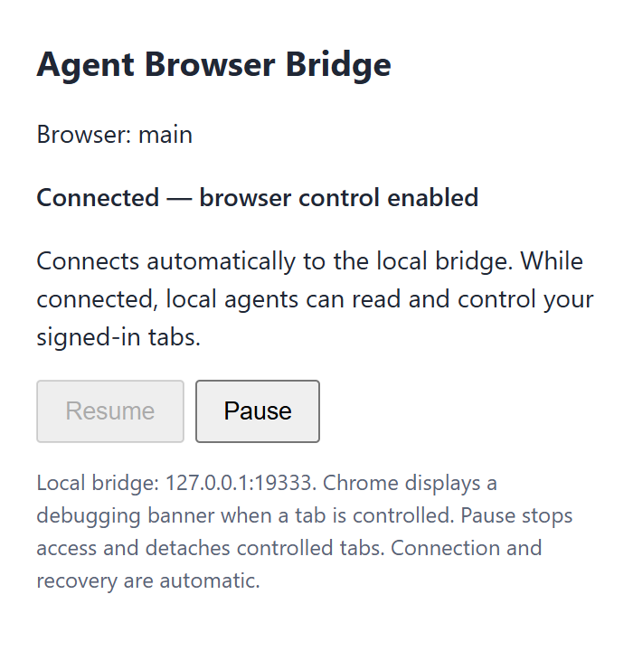
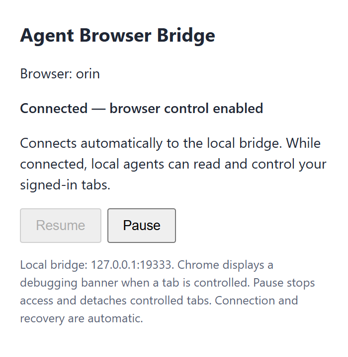

# Agent Browser Bridge


Control your existing, signed-in Chrome from any agent that can run a shell command or connect to an MCP server. Install the unpacked extension in the Chrome profile you already use. It connects automatically to a local service and controls that profile's existing tabs with their existing cookies and logins. No token or pairing step is required. You do not need a separate browser, a remote debugging launch flag, or to export cookies.

Control multiple Chrome profiles through one bridge, select them by nickname, upload files, retrieve downloads, take screenshots, and record silent video. Agents on another machine can use the same browsers through an SSH tunnel.

| `main` profile | `orin` profile |
| --- | --- |
|  |  |

Actual extension screenshots from two disposable Chromium profiles connected to one bridge. Each profile has its own identity and nickname. Normal use connects automatically; **Pause** stops access to that profile.

This is an early developer release, available as an unpacked extension. Automated tests exercise the CLI, MCP, two isolated Chromium profiles, cookie isolation, uploads, downloads, managed groups, screenshots, and video. Individual agent configurations and your signed-in browser profile require separate validation.

## Install and start

Requires Node.js 22 or newer and Chrome 120 or newer.

1. Clone this repository and run `npm install` in its directory.
2. Open `chrome://extensions`, turn on **Developer mode**, click **Load unpacked**, and select this repository's `extension` directory.
3. Run a browser command. It starts the local bridge if needed and waits for the extension to connect automatically:

```sh
node bin/cli.js call tabs.list '{}'
node bin/cli.js status
```

No popup interaction is needed for normal use. Browser commands wait up to 35 seconds for the installed extension; `status` reports the current state without starting a bridge. `npm start` remains available to run the bridge in the foreground. Use **Pause** in the popup to explicitly pause browser access, and **Resume** after that deliberate pause. Temporary connection failures and bridge restarts reconnect automatically. Chrome displays its debugging indicator when a tab is being controlled.

If updating an older unpacked extension, reload it once in `chrome://extensions` to refresh its popup and service worker. No pairing token is needed.

## Browser nicknames

Give your connected Chrome profile a memorable name, then select it explicitly in agent commands:

```sh
node bin/cli.js browser
node bin/cli.js browser name main
node bin/cli.js browsers
node bin/cli.js --browser main call tabs.list '{}'
node bin/cli.js --browser orin call tabs.list '{}'
```

`browser` reports the connected browser's ID, nickname, and connection state. Names start with a letter, contain up to 32 letters, digits, underscores, or hyphens, and are stored in lowercase. Each nickname belongs to one browser. Names persist in `~/.agent-browser/browser-names.json` across bridge restarts.

Use `--browser main` to pin commands to that browser. A mismatched or disconnected selection fails instead of controlling whichever browser happens to be connected. You can also select the stable browser ID. Omitting the selector works when exactly one browser is connected; with multiple connections, select one explicitly.

Install the extension in each Chrome profile you want to control. Name each profile while it is selected, then use `browsers` to inspect connected IDs and nicknames. For example, keep your everyday profile named `main` and another named `orin`, and pass the desired name with each agent command.

One shared bridge on port `19333` supports multiple profiles concurrently. Load the **same extension directory** in each profile; do not copy the extension, edit its port, or start a service per profile. Each profile stores its own stable UUID. Use `--browser ID browser name NAME` to assign any nickname, then select it on each CLI command or with the MCP tool's `browser` property. Offline aliases remain visible in `browsers` with `connected: false`. Different profiles can work concurrently; actions within each profile are serialized. A single SSH tunnel carries every profile to remote agents.

If an agent claims only one profile is supported, have it read this checkout's current skills and tool definitions. After upgrading an older unpacked extension, reload it once in each profile to activate the worker's UUID identity. Normal operation needs no Connect click.

## Managed browser tabs

Tabs created, navigated, or inspected through page commands are automatically placed in a visible agent group labeled with the browser nickname, such as `🤖 Agent · main`. `tabs.list` reports each tab's `groupId` and `managed` state.

```sh
node bin/cli.js --browser main call groups.list '{}'
node bin/cli.js --browser main call groups.release '{"tabId":123}'
node bin/cli.js --browser main call groups.manage '{"tabId":123}'
```

Releasing a managed tab ungroups it and detaches the debugger. Inspecting or controlling it again can manage it again. `groups.manage` optionally accepts `title` and `color` for a custom group appearance.

## Uploads and downloads

Upload a file from the agent's computer into a page's file input:

```sh
node bin/cli.js --browser main upload 123 'input[type=file]' ./report.pdf
```

The client transfers the file to the desktop bridge and selects it in the page; submit the form separately when intended. This works through the SSH tunnel too, so remote agents do not need a desktop filesystem path. Multiple files may follow the selector. MCP `page_upload` performs the same transfer. Generic `page.upload` calls instead require paths that already exist on the desktop.

Staging accepts up to 64 MiB per file. Copies remain under `~/.agent-browser/uploads` on the desktop so a page can submit them later. CLI and MCP upload read specific client paths; generic page upload validates specific desktop paths. This does not provide a general filesystem browsing interface.

```sh
node bin/cli.js --browser main download https://example.com/report.pdf --filename reports/report.pdf
node bin/cli.js --browser main downloads list
node bin/cli.js --browser main downloads info 5
node bin/cli.js --browser main downloads wait 5
node bin/cli.js --browser main downloads save 5 --output ./report.pdf
```

Use the download ID returned by `download`. Metadata reports the state and absolute `filename` on the Chrome computer, including when the agent runs remotely. An optional filename is relative to Chrome's downloads directory; wait for completion before using the file. Downloading through Chrome preserves the selected profile's existing login session.

`downloads save` copies a completed Chrome download to a new file on the agent's computer, including through the SSH tunnel. It does not overwrite existing output files. MCP `downloads_save` provides the same transfer. The Chrome metadata's absolute desktop filename and the agent's chosen output path belong to different computers when used remotely.

## Screenshots and video

Get a tab ID from `tabs.list`, then save a screenshot directly to a new file:

```sh
node bin/cli.js --browser main screenshot 123 --output screenshot.png
```

A `.jpg` or `.jpeg` output suffix selects JPEG; other suffixes produce PNG. Existing files are not overwritten. MCP `page_screenshot` returns image content directly, and the generic `page.screenshot` command returns base64 data.

Record a tab to silent WebM video:

```sh
node bin/cli.js --browser main record start 123 --output demo.webm
node bin/cli.js --browser main record list
node bin/cli.js --browser main record stop RECORDING_ID
```

Use the recording ID returned by `record start`. Install FFmpeg on the computer running the bridge and make `ffmpeg` available on PATH, or set `AGENT_BROWSER_FFMPEG` to its executable path. Recording captures browser frames without audio. With a remote agent, recording output paths refer to the computer running the bridge.

## Agents on Hetzner or another SSH host

Keep Chrome and the extension on your own computer. From that computer, open a reverse SSH tunnel to a host in your SSH configuration:

```sh
node bin/cli.js tunnel hetzner
```

Leave that command running. It forwards the bridge to a loopback listener on the remote host. On the remote host, install this project and run:

```sh
node bin/cli.js --no-autostart --browser main call tabs.list '{}'
```

For a remote MCP client, set `AGENT_BROWSER_AUTOSTART=0` in its environment, or put `--no-autostart` before `mcp` in the launch arguments. This prevents the remote agent from starting a separate bridge if the tunnel goes down. `tunnel hetzner --remote-port 19334` chooses another remote port; set `AGENT_BROWSER_PORT=19334` on the remote client to match. The remote host and its local processes gain browser control while the tunnel is open, so use a host you trust and keep the listener on loopback.

## Use from an agent

Repository-local skills are available as [browser-control](skills/browser-control/SKILL.md) for local agents and [remote-browser-control](skills/remote-browser-control/SKILL.md) for agents on Hetzner or another SSH host. They resolve the CLI relative to this checkout and do not install anything into your agent configuration.

Give any shell-capable agent the absolute path to this checkout and tell it to run commands such as:

```sh
node /absolute/path/to/agent-browser/bin/cli.js call tabs.list '{}'
```

For an agent launched with `zcy`, install the extension once, then launch your usual `zcy` session and give the agent the checkout path and command above. Its first browser command starts the bridge and waits for Chrome automatically. No special `zcy` flags or browser-specific integration are required. Its execution environment must have access to Node.js and this local bridge.

PowerShell can invoke the CLI directly:

```powershell
node .\bin\cli.js status
node .\bin\cli.js call tabs.list '{}'
```

For parameters containing JSON quotes, use stdin to avoid PowerShell's native argument quoting differences:

```powershell
'{"tabId":123}' | node .\bin\cli.js call page.snapshot --stdin
```

Replace `123` with an ID returned by `tabs.list`.

For non-ASCII parameters on Windows PowerShell 5.1, save the JSON as UTF-8 and use `--params-file params.json`, or set `$OutputEncoding` to UTF-8 before piping. PowerShell 7 uses UTF-8 by default.

## MCP

Configure your agent's stdio MCP client to launch:

```sh
node /absolute/path/to/agent-browser/bin/cli.js mcp
```

A typical client configuration looks like this; exact configuration location and schema depend on your agent:

```json
{
  "mcpServers": {
    "browser": {
      "command": "node",
      "args": ["/absolute/path/to/agent-browser/bin/cli.js", "mcp"]
    }
  }
}
```

On Windows, use an absolute Windows path with JSON-escaped backslashes, such as `C:\\Users\\you\\git\\agent-browser\\bin\\cli.js`. MCP browser calls start the bridge if needed and wait for the installed extension without credentials or popup interaction.

MCP provides `browser_info` and `browser_rename` (with `name`, such as `main`). Every tool accepts an optional `browser` argument to select a nickname or browser ID. For example, call `tabs_list` with `{"browser":"main"}`. You can also pin the MCP server by adding `"--browser", "main"` before `"mcp"` in its launch arguments.

## Browser commands

Pass parameters as one JSON object after the method name. Get tab IDs from `tabs.list`, then inspect a page before interacting with it.

| Method | Parameters |
| --- | --- |
| `browser.info` | `{}`; returns browser ID, nickname, and connection state |
| `browser.rename` | `name`; assigns a persistent nickname |
| `browsers.list` | `{}`; lists connected profiles and saved offline aliases |
| `tabs.list` | `{}` |
| `tabs.create` | `url?`, `active?` |
| `tabs.close` | `tabId` |
| `tabs.navigate` | `tabId`, `url` |
| `page.snapshot` | `tabId`, `maxLength?`; returns page text and interactive element selectors |
| `page.click` | `tabId`, `selector`, or `tabId`, `x`, `y` |
| `page.type` | `tabId`, `text`, `selector?`, `clear?` (defaults to true) |
| `page.key` | `tabId`, `key`, `code?`, `modifiers?` (numeric CDP bitmask) |
| `page.scroll` | `tabId`, `x?`, `y?` (defaults to 600) |
| `page.evaluate` | `tabId`, `expression` |
| `page.screenshot` | `tabId`, `format?` (defaults to png), `quality?`, `fullPage?`; returns base64 `data` |
| `page.upload` | `tabId`, `selector`, `files`; absolute paths on the Chrome computer; prefer CLI `upload` or MCP `page_upload` for client files |
| `downloads.start` | `url`, `filename?`; starts a Chrome download |
| `downloads.list` | `limit?`, `state?`; returns download metadata |
| `downloads.info` | `id`; includes the absolute saved filename |
| `downloads.wait` | `id`, `timeoutMs?`; waits up to 25 seconds for completion |
| `groups.list` | `{}`; lists tab groups |
| `groups.manage` | `tabId`, `title?`, `color?`; groups a controlled tab |
| `groups.release` | `tabId`; ungroups and detaches a managed tab |
| `cdp.send` | `tabId`, `method`, `params?`; sends a Chrome DevTools Protocol command |

## Trust and limitations

Any local process that can reach the running bridge can control the connected browser. Use it on a trusted computer with trusted local agents and processes. An agent can read page content and perform actions using your account, including actions with real consequences. This tool does not ask for confirmation before each action. Use **Pause** in the extension to pause browser access: browser calls can restart a stopped bridge automatically.

The bridge binds to `127.0.0.1`, requires the expected loopback Host, and rejects HTTP requests carrying an Origin header. Extension WebSockets require a Chrome extension origin and a `hello` handshake with protocol version `1`. Multiple profiles connect using independent browser IDs. A legacy `auth` handshake is accepted temporarily so an already installed extension can transition; its token is not validated. These checks restrict website access and do not authenticate local processes. Keep the service off public interfaces; for remote access, use the loopback SSH forwarding described above with a trusted host.

Chrome restricts debugging of internal pages and some protected tabs. Other debuggers, including DevTools, can interfere with attachment. Browser command failures and disconnects can occur after an action has already executed; inspect the page before retrying a consequential command.

`AGENT_BROWSER_PORT` configures the local CLI/service port (default `19333`). The unpacked extension currently connects to port `19333`; changing the service port also requires updating its connection URL and content security policy.

## Development

```sh
npm ci
npm run check
npm test
```

Tests use real loopback HTTP and WebSocket connections with a mock extension. They do not require Chrome or access real browser accounts.

To run the real unpacked extension in a disposable Chromium profile:

```sh
npx playwright install chromium
npm run test:browser
```

On Linux, install browser system dependencies with `npx playwright install --with-deps chromium`. Install FFmpeg for the recording checks. The test defaults to port `19333`; stop an existing bridge first or set `AGENT_BROWSER_TEST_PORT=19335` to leave it running. With another port, the test adjusts a temporary extension copy.

The browser test verifies automatic connection and recovery, independent profiles and cookies, CLI and MCP actions, file uploads, download paths and retrieval, managed groups, screenshots, and decodable video. It creates and removes disposable browser profiles and never loads your personal Chrome profile or logins. This test runs separately from `npm test`.

To regenerate the README screenshots, run `node scripts/capture-readme.js`. It uses two disposable Chromium profiles and a separate bridge on port `19336`. Install Playwright Chromium first; no personal browser session is used.

To verify a Chrome profile that is already connected, run `npm run test:connected`. This opens a temporary local test page, exercises page actions and navigation, and closes its tab afterward. It leaves other tabs and cookies unchanged. Navigation commands return before the destination finishes loading; wait for the tab's `status` to become `complete` before interacting with it, and allow asynchronous page updates to finish before checking their results.

MIT licensed. See [LICENSE](LICENSE).
